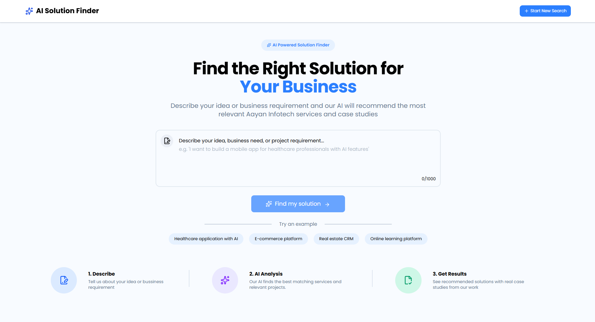

# AI Solution Finder 🚀

**Turn your business requirements into actionable software recommendations.**

AI Solution Finder is an AI-powered web application that analyzes business requirements and recommends relevant software services and complementary projects. It combines a custom recommendation engine with AI-generated insights to help users identify suitable software solutions.



🌐 **Live Demo:** [AI Solution Finder](https://ai-solution-finder.vercel.app)

💻 **GitHub Repository:** [AI Solution Finder](https://github.com/jawahaartheella/ai-solution-finder)

## ✨ Features

- **Business Requirement Analysis:** Accepts natural-language descriptions of software requirements.
- **Service Recommendations:** Matches requirements against predefined services using industry relevance, platforms, features, and keywords.
- **Match Percentage:** Calculates service relevance scores to help users compare recommendations.
- **Project Recommendations:** Suggests complementary projects with independently calculated match scores.
- **AI-Powered Insights:** Integrates the Groq API to generate contextual insights based on user requirements.
- **Fallback Recommendations:** Provides a general-purpose software service when no specialist service meets the configured matching threshold.
- **Loading and Error States:** Handles asynchronous requests and displays feedback when something goes wrong.
- **Responsive UI:** Provides a responsive interface built with Angular and Tailwind CSS.
- **Session-Based Results:** Preserves generated results across page refreshes within the same browser session.
- **Separate Deployments:** Hosts the frontend and backend independently on Vercel.

## 🛠️ Technologies Used

### Frontend
- Angular
- TypeScript
- Tailwind CSS
- Lucide Angular
- RxJS
- Browser `sessionStorage`

### Backend
- Node.js
- Express.js
- TypeScript
- Groq API and Groq SDK
- JSON-based service and project datasets
- dotenv
- REST API

### Tools and Deployment
- Git and GitHub
- Vercel

## 🧠 How It Works

1. The user enters a business requirement.
2. The Angular frontend sends the requirement to the Express backend.
3. The recommendation engine evaluates the requirement against predefined service data.
4. Matching services are scored and ranked based on relevant industries, platforms, features, and keywords.
5. Relevant projects are matched and scored separately.
6. The Groq API generates contextual AI insights as part of the recommendation workflow.
7. The results are returned to the frontend and displayed to the user.

**Key Design Decision:** The application uses deterministic TypeScript logic for recommendation matching and scoring, while AI generates contextual insights. This separation keeps the core matching process predictable and easier to maintain.

## 🚀 Getting Started

### Prerequisites

- Node.js and npm
- Git
- A Groq API key

### 1. Clone the Repository

```bash
git clone https://github.com/jawahaartheella/ai-solution-finder.git
cd ai-solution-finder
```

### 2. Set Up the Backend

```bash
cd server
npm install
```

Create a `.env` file inside the `server` directory:

```env
GROQ_API_KEY=your_groq_api_key
```

Start the backend using the development script configured in `server/package.json`:

```bash
npm run dev
```

The backend runs at `http://localhost:3000`.

### 3. Set Up the Frontend

Open a separate terminal from the project root:

```bash
cd client
npm install
npm start
```

If `npm start` is not configured, use:

```bash
npx ng serve
```

Open `http://localhost:4200` in your browser.

### 4. Configure the API URL

For local development, configure the frontend to use:

```text
http://localhost:3000/api/solution
```

For production, use:

```text
https://ai-solution-finder-server.vercel.app/api/solution
```

**Security Note:** Never commit `.env` files or API keys to GitHub. Configure production secrets through Vercel's environment variable settings.

## 🌐 Deployment

The application is deployed on Vercel as two separate projects.

- **Frontend:** https://ai-solution-finder.vercel.app
- **Backend:** https://ai-solution-finder-server.vercel.app

The frontend communicates with the backend through a REST API.

## 💡 Key Learnings

- Integrating an LLM API into a full-stack web application.
- Building a recommendation engine using TypeScript.
- Combining deterministic business logic with AI-generated insights.
- Structuring a backend with Express routes, controllers, and services.
- Handling API errors and asynchronous frontend requests.
- Managing environment variables and API credentials securely.
- Deploying and troubleshooting frontend and backend applications independently.

## 👨‍💻 Author

**Jawahaar Theella**

[GitHub Profile](https://github.com/jawahaartheella)